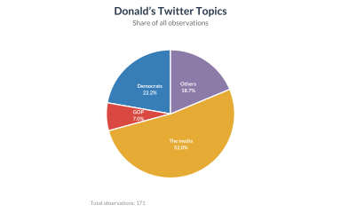

## Basic

Pie charts visualize how individual categories contribute to a whole, with each slice representing a proportion of the total. They work best when the number of categories is limited and the differences between shares are easy to distinguish.


The pie chart of Donald’s Twitter data illustrates the distribution of observations across four topic groups: Democrats, GOP, the media, and others. Each slice represents the proportion of total observations associated with a topic. 

**One word of caution**: Pie charts divide a circle of 360 degrees into slices, with each slice showing a share of the total. However, they do not show the actual numbers, and it can be hard to compare slices of similar size. The shares also describe only the data collected, not necessarily the whole population or the importance of each category.

```r
!r(plot01.R)
```




