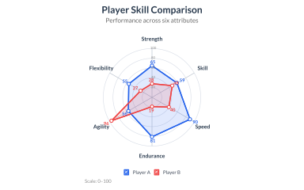

## Basic

## Radar Chart

Radar charts are useful for comparing multiple variables across different categories. They display multivariate data on axes arranged radially around a central point, making it easy to identify strengths, weaknesses, and differences between observations.

In this example, we compare two players across six performance attributes: Strength, Skill, Speed, Endurance, Agility, and Flexibility. Each axis represents one attribute, while the distance from the center indicates its value on a scale from 0 to 100.

The overlapping polygons make it easy to identify where each player performs better and how their overall skill profiles differ. Radar charts are particularly useful for comparing profiles, evaluating performance, and visualizing strengths across multiple dimensions.


```r
!r(plot01.R)
```




```jsx
!js(plot01-js.jsx)
```

!plot(plot01-js.jsx)

