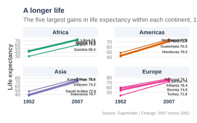
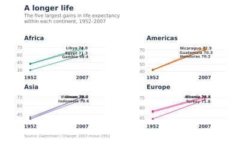

## Basic

A slope chart displays changes in a numerical variable between two points in time, making it easy to compare trends, identify the largest increases or decreases, and highlight differences between groups.

The following plot uses a slope chart to show changes in life expectancy between 1952 and 2007 for the five countries with the largest gains within each continent, using the Gapminder dataset. Each line represents a country, with its endpoints showing life expectancy at birth in 1952 and 2007. Countries are grouped by continent, and labels indicate their 2007 life expectancy. The plot helps reveal how life expectancy improved across countries over time and highlights the countries that experienced the greatest gains during this period.


```r
!r(plot01.R)
```



```python
!py(plot01.py)
```

