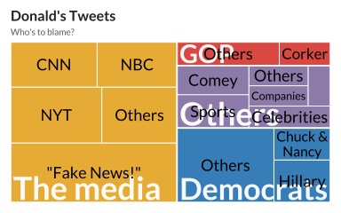

## Basic

A treemap shows how quantities are distributed across categorical groups, with larger areas representing larger groups. This makes it possible to compare the relative size of categories and identify which groups account for the largest or smallest shares of the total. Treemaps are particularly useful when the relative magnitude of several categories is more important than the individual observations.


The following treemap illustrates the distribution of topics in tweets scraped from Donald Twitter account. Each rectangle represents a topic or subtopic, with its area proportional to the percentage of tweets associated with that category. The colors distinguish the main topic groups, highlighting differences in the distribution of Donalds tweets across political figures, the media, and other subjects.


```r
!r(plot01.R)
```


