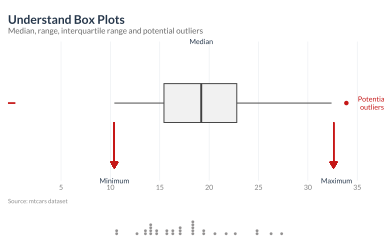
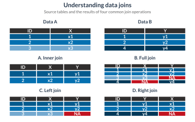
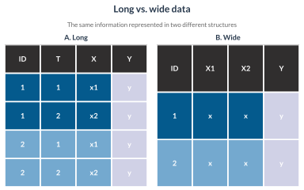
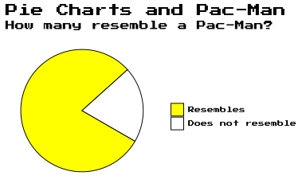
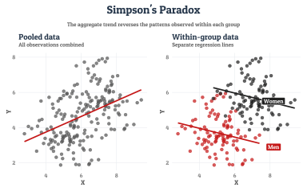

## Boxplot

Box plots provide a concise visual summary of a data distribution, highlighting the median, interquartile range, overall spread, and potential outliers. They make it easy to compare variability, identify skewness, and detect unusually high or low observations. Combined with individual data points, they offer additional insight into the distribution and density of the underlying data.


```r
!r(boxplots.R)
```




## Data Joins

The plot illustrates how different data joins combine two datasets based on shared identifiers. It compares inner, full, left, and right joins, showing which observations are retained, how matching records are combined, and where missing values appear when no corresponding match exists.


```r
!r(data_joins.R)
```




## Long Wide

The plot compares long and wide data formats, illustrating how the same information can be organized in different table structures. Long format stores repeated observations across rows, whereas wide format spreads related values across separate columns. Understanding these formats helps when reshaping data for analysis, visualization, and statistical modelling.


```r
!r(longwide.R)
```




## Pac-Man

The plot makes a playful visual joke by comparing pie charts to Pac-Man, using retro gaming typography and bright yellow coloring to reinforce the nostalgic arcade aesthetic.

```r
!r(pacman.R)
```




## Simpson's Paradox

Simpson’s paradox occurs when a trend observed within separate groups reverses or disappears when the groups are combined. The graph illustrates how an overall relationship can differ from the relationships observed within individual subgroups, highlighting the importance of considering group structure and potential confounding variables when interpreting data.


```r
!r(simpson.R)
```




